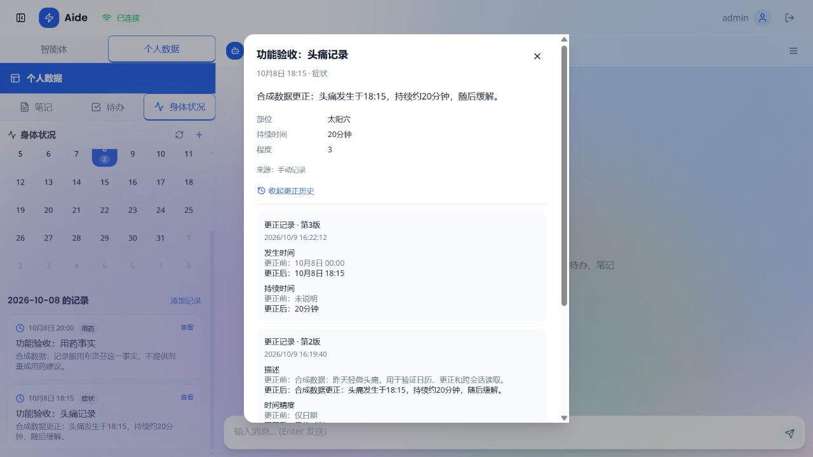

# 健康记忆日历与实际链路验收

验收日期：2026-10-09；收尾与正常服务恢复：2026-10-10。对应主方案M2c，并修复验收发现的MCP生命周期问题（M4部分）。

## 实现

- 新增日历汇总接口 `GET /api/health-records/{user_id}/calendar?month=YYYY-MM`：对日期范围全部有效记录分组计数，不先截取500条正文。
- 原记录列表加入offset、returned、has_more和全量total/daily_counts。前端按天每页50条加载，月份汇总与日记录独立请求；503条测试证明计数不受分页影响。
- 月份/日期/用户变化时取消旧请求并丢弃旧响应，渲染时核对scope，防止短暂显示上一用户或上一日期的数据。切到邻月日期时同时切换月份。
- 详情打开后重新请求当前记录与更正历史；历史独立报错。更正表单携带expected_revision，冲突提示重新加载；未编辑时间保留原始精度和秒，结构化详情编辑保留私有时间来源。
- 创建请求在相同内容重试时复用key，改变内容时更换key；同步in-flight标记防重复点击。对话完成事件触发日历刷新，另有手动刷新入口。
- 对话来源显示原始时间表达与“医疗对话”；仅日期、推定时间与具体时刻区分。历史展示更正前后，不把内部元数据当健康事实。
- 详情键盘Escape/Tab与焦点恢复、可读字段名称、长文本/窗口高度已检查。兼容模型此前输出的中文详情键，不自动追加同义空字段。
- 健康记录摘要归Medical Agent；模型须实际读取health_get_records，按发生时间整理。分页未读完不能声称全部。工具计算date_label（含正确星期），模型直接引用。

## 端口与运行

前端API和WebSocket都走同源代理；Vite读取 `AIDE_API_BASE_URL`。Windows启动脚本支持BackendPort/McpPort/RestartFrontend，MCP监听与API连接读取同一配置。未指定端口时复用本项目的已有监听；不停止其他工作树。

```powershell
# 默认8000被其他程序占用时
.\启动Aide.ps1 -AllowOffline -BackendPort 8004 -McpPort 8002
# 已运行前端的代理地址变化时显式重启本项目前端
.\启动Aide.ps1 -AllowOffline -BackendPort 8004 -RestartFrontend
.\启动Aide.ps1 -Status
.\scripts\test-aide-runtime.ps1
```

预检Python/Vite/Node和必要网络条件先于停止旧前端。故意传不存在Node路径，应失败且保留原前端PID。`AllowOffline`只跳过TCP探测，不表示模型一定可用。固定端口冲突仍明确报错；代码更新后的进程重启须核对归属。

## 隔离验收环境

`backend/data/memory_acceptance_20261009/` 保存独立SQLite、Chroma和笔记索引。原用户数据没有复制到此环境；预置两条合成事件，再由真实对话增加一条体温事实。复用本机中文72篇/95块做检索，不使用Huatuo候选。

```powershell
# 在backend目录准备固定样本
.\.venv\python.exe -m medical.prepare_memory_demo --directory data/memory_acceptance_20261009 --reference-date 2026-10-09
# 浏览器步骤完成后，只读核对固定样本持久化结果
.\.venv\python.exe -m medical.verify_memory_demo data/memory_acceptance_20261009
```

准备独立医疗索引需将CHROMA_PERSIST_DIR设为该目录的chroma后运行既有sync --research。启动验收时同一父进程传入SQLITE_PATH、CHROMA_PERSIST_DIR、AIDE_NOTE_INDEX_DIR；本机生成模型配置保持原官方DeepSeek。验收结束恢复默认.env数据库与索引，避免用户继续操作合成数据。固定脚本核对的是2026-10-09样本，不是对任意日期的通用医学评估。

## 实测结果

- 正式TypeScript检查、Vite生产构建通过；6项前端时间/日历/保存key/历史辅助测试通过；20项端口/归属检查通过。
- 后端联合84项测试通过，日志 `logs/portfolio-calendar-regression-tests.log`。503条日期分页/总数、用户过滤、来源防伪、更正版本、回滚、任务归属均覆盖。
- 页面：月份显示2条→点击10月8日看到两条→将头痛更正到18:15并补充持续时间/程度→详情/历史与SQLite一致，版本1→2→3；快速前后切月正确恢复统计。
- 实际WebSocket/Runner/官方LLM：Triage→Medical→health_create_record保存2026-10-09 09:00、36.8℃；数据库来源message ID=3，确为已保存human消息，同源conversation一致。
- 新会话：Triage→Medical→health_get_records读2026-10-03至09全部3条；回答包括更正后18:15、20:00用药事实和09:00体温。源会话与摘要会话不同，不能依赖聊天上文伪造记忆。
- 星期复验：工具给出10月8日周四、10月9日周五，最终回答正确。查询和科普后健康记录总数仍3，没有额外写入。
- 实际MCP医疗检索与模型回答仍成功，最终来源元数据包含NHC-HL2024-32，页面显示政府PDF来源卡片；不是只测本地工具函数。
- 持久化核对报告 `backend/data/memory_acceptance_20261009/acceptance.json` 的7项checks均true，passed=true。生成接口确有调用；未量化本轮token与成本，不虚报用量。



## 保留的问题与修复

1. 首次摘要被路由至Personal Assistant，它查询notes/todos后误称无健康记录。已明确健康记录/健康日记/周摘要归Medical，并加入路由回归；失败对话仍保存在隔离样本中。
2. 第一次星期标签被模型按错年份推算。加入后端date_label及提示词约束，后续真实回答正确。不能由此保证所有自由文本日期零错误。
3. MCP客户端在首个WebSocket任务中初始化，页面断开/并发初始化时出现跨任务退出cancel scope、异步生成器关闭异常。新增MCPConnectionOwner，连接/关闭在同一长驻任务；PerformanceManager初始化共享一次任务并shield等待者取消，应用关闭显式清理。受控生命周期测试及后续真实请求通过，新日志未再出现这两类异常。
4. Playwright fill日期控件未触发React状态更新，首次更正仅修改了其他字段；改用浏览器原生setValue后，界面、历史和SQLite确认18:15。这是自动化输入方式问题，不把它写成服务端时间算法修复。
5. 模型详情字段可出现“体温”等中文键；编辑器兼容它们，尚无完整标准化抽取评测。复杂字段更正也不自动重写标题/摘要，用户需核对描述一致性。
6. 10月10日默认沙箱对Vite realpath(main.tsx)返回EPERM；授权环境构建通过。预检保留前端测试最初引用隔天失效PID，改为实时读取进程后再检查；不把过期PID当作程序被误停的证据。

## 边界与下一步

本轮是少量有监督合成流程，不是医疗正确性、生产负载或完整网络故障验收。确认健康记录流程中部分明确场景可用；不宣称LLM的任意抽取/摘要完全准确。医疗人员审核继续暂缓。

M1b需加入独立表达、结构化字段与文本冲突、时间歧义和错误资源路由；M1c评估答案事实与来源。M4剩余任务预算/取消/请求级幂等及M6真实网络矩阵仍未完成。
