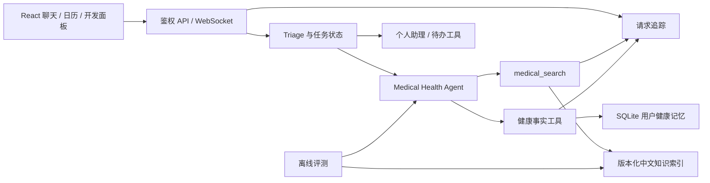

# Aide 项目升级执行方案

制定日期：2026-10-06。状态：用户已授权设计、记录并逐模块开发。

本文件是后续开发的主计划；实际完成情况、提交、测试和失败项写入 `portfolio-progress.md`。旧 RAG 和笔记文档作为历史记录保留，不把旧验收结果当作新版本结果。

## 1. 产品目标与交付边界

定位：面向中文健康场景、具备个人记忆与工具协作能力的可追溯 AI 助手。本机研究，成年人一般健康科普、就医引导、用户明确健康事实记录。医疗人员审核暂缓；公开发布单独决定。

核心演示：用户说“昨天头痛，晚上服用了布洛芬”→记录事实与正确日期→补充具体时间后修改原记录→日历查看→另一个会话整理最近一周记录→创建复盘待办。问答无论资料命中与否均由项目统一 LLM 参与；缺乏资料时如实给一般性解释，不伪造引用。

工程证据：固定评测、对照实验、失败分析、可追溯请求、可复现启动、故障恢复。所有简历数字须关联数据集哈希、代码提交、运行条件和报告；不把测试目标写成已实现结果。

## 2. 当前基线

- 分支 `codex/medical-rag-data-upgrade`，起点 `5b2b1b7`。
- 研究回答库 72 篇中文资料、95 chunks；仅原文核对。Huatuo 5000 候选独立研究，不进入回答依据。
- 医疗检索：BGE-small-zh-v1.5（512 维）+ jieba/BM25 + 加权 RRF + BGE-reranker-base。模型版本/权重已固定。
- 生成：统一 LiteLLM model factory；不另建医疗专用模型配置。
- 笔记：SQLite 为权威原文，FTS 与 Chroma 为索引，事务 outbox、读时版本与所有权核对，已有词法覆盖门槛；口语漏例仍存在。
- 健康：本地 `health_records`、月/日/详情界面、CRUD 和 MCP 工具。缺少数据库级写入幂等、可靠日期歧义处理、变更历史和完整闭环测试。
- 已有评测：111 开发题、33 历史回归题、10 中文补充题及笔记合成题。历史回归含移除英文 ID，不能悄悄重标；不是独立盲测。
- 上轮联合测试 32 项、正式前端构建通过；本轮变更必须重新验收适用范围。

## 3. 技术选择与模块关系

继续使用 FastAPI、SQLAlchemy、SQLite、Chroma、项目现有 Agent SDK/MCP、LiteLLM、React/TypeScript/Vite。模块通过窄接口连接，暂不迁移整个 Agent 框架。

开源参考先检索 GitHub，按具体缺口引入：

- [FlagEmbedding](https://github.com/FlagOpen/FlagEmbedding)：沿用本地 embedding / reranker 路线。
- [Ragas](https://github.com/vibrantlabsai/ragas)：参考检索和答案评估，后续作为可选 judge adapter；现阶段确定性检索指标复用已有评估器，避免无必要依赖。LLM judge 不作为医学正确性证明。
- [Langfuse](https://github.com/langfuse/langfuse)：参考 trace/span、提示词版本、实验关联；先实现轻量本地事件契约，后续按本机资源接入 adapter。
- [SQLAlchemy 事务](https://docs.sqlalchemy.org/en/20/orm/session_transaction.html)：利用数据库唯一约束和事务实现幂等，不依赖单进程内存去重。

## 4. 模块 M1：统一评测与实验管理（P0）

### M1a 可复现运行基础

- 固定 suite manifest：版本、题集路径/哈希、用途（开发/回归/新冻结）、指标定义、参数文件。
- 对照配置：关键词 baseline、纯 BGE、BGE+BM25/RRF、融合+reranker。明确每种模式候选池、过滤和 Top K 定义，记录降级而非冒充重排成功。
- 默认在临时 Chroma 对当前中文 corpus 建库，不修改用户数据库、在线集合、模型配置。固定语料时间截点，报告来源资格与过期情况。
- 每份报告记录 corpus 哈希、模型 revision/权重、chunk 策略版本、代码提交与是否 dirty、题集哈希、CPU线程、参数、模式、初始化/首查/其余查询耗时、进程内存和逐题候选。
- 修正 MRR@K 截断与题集输入验证；旧指标版本明确区分，不直接混比。
- 同一题集/语料快照才允许报告模式差值。历史外文 ID 的缺口单独报告；通过重新命名预期提升分数属于无效验收。

### M1b 题集扩展

目标约 240 题（规划值，不是已完成数量）：120 开发、80 新冻结测试、40 故障/协作/记忆流程。按主题分层，避免同一模板改写横跨开发/测试。冻结集被用于调参后改称回归集，另补未见集。

类别：直接问法、口语/错字、否定、相近主题干扰、无资料、短追问、混合意图、工具错误、时间歧义、重复调用、跨用户访问。标签包含 relevant/forbidden IDs、切片或原文定位、答案应覆盖要点、允许一般知识及不能推出的结论。

开发者编写与生成式样例标记来源；外部盲测数量单列。健康题使用合成情况，默认不复制用户病情。资料没有支持的主题先进入 coverage backlog。

### M1c 答案与任务效果

显式 live 模式通过统一 LLM，保存模型、提示词哈希、token、费用估算依据与 trace。检索命中/未覆盖/不可用都验模型参与。答案断言抽取、证据支持、引用一致性和问题回应分别评分，judge 模型与提示词固定，抽样复核 judge 分歧；不给单个综合分冒充真实性。

验收：无空集/重复 ID/未知标签静默通过；MRR@K、多正例 Recall/nDCG 定义有测试；两次固定配置可核对相同版本；至少四模式对照可运行；失败和 fallback 保留。延迟/质量先建基线，再定改善目标。

## 5. 模块 M2：健康事实记忆闭环（P0/P1）

### M2a 时间与写入基础

- 统一时间为 Asia/Shanghai 的无时区数据库墙钟值，外部带 offset 的 ISO 先转换再去 tzinfo；不用直接丢弃时区。
- 相对日期基于明确参考时刻；支持昨天/前天、上周指定星期、完整日期、带日期的明确时分。只有日期存 00:00 并标记 day；“晚上”不伪造具体时刻。
- “20号”、未说明年的月日、多日期混写、未来日期等有歧义时返回 `needs_clarification`，不自动猜最近过去月份。用户澄清后用完整日期写入。
- 无时间表达才用本次参考时间，precision=unknown/confidence=inferred_time。保存用户时间原话与解析版本，方便日历解释。
- 创建支持 idempotency_key；用户+操作 key 唯一，payload 哈希检测同 key 不同内容，创建与幂等回执同事务。重复请求返回原 ID，已删除记录不得被旧请求复活。
- 采用新增小表实现约束，现有 health_records 无破坏性变更；老记录保留原值。迁移前 SQLite backup，新增表可重复执行，回退代码保留表与数据。

### M2b Agent 接入与修正历史

- 从鉴权上下文绑定 user_id/conversation/message，写入幂等键由可信执行上下文生成，不让模型任意冒充用户或来源。
- 明确新增与更正：用户补充某条事实，使用原 ID 更新；不以标题/相似度自动合并不同事件。多个候选时先问。
- 修改校验允许字段，保留更正前后快照、操作来源与时间；权限不能被字段赋值覆盖。读取/修改/删除均按 owner，健康原文不写普通运行日志。
- 失败状态不能伪装成空列表或成功；记录成功确认依工具真实回执。

### M2c 跨会话读取与前端

- 按日期、类型、记录 ID 读取最少必要事实，设置数量与上下文预算；不默认全量健康史进入每次对话。
- 周摘要附记录 ID/日期出处，不生成诊断；修改/删除后下一轮不使用旧记录。
- 日历显示日精度/具体时刻/推定时间与原表达；数据较多时准确按月统计和分页，不能把 limit 后计数伪装全量计数。
- 验收场景：昨天用药、上周三、跨月/跨年、带 offset、歧义、重复工具调用、并发重复请求、后续修正、另会话读取、跨用户拒绝、软删除、日历刷新。

## 6. 模块 M3：中文知识数据流水线（P0/P1）

围绕 coverage backlog 逐主题增加原文可定位的中文资源；先常见腹痛、一般发热、睡眠、运动与营养等缺口，主题是否满足看评测，不以篇数验收。

数据层：raw（版本化原始快照）→normalized（语言、来源、适用范围）→validated（哈希/许可/重复/关键条件）→chunks（策略版本、原文偏移）→staged index→验收→active pointer。

文章按章节；问答保留单元；表格重复必要表头；条件/禁忌与适用人群尽量同块。比较固定窗口与结构策略的 Recall、上下文完整性、token 和重排耗时。原文与索引仍在 D 盘规则目录。

增量构建只处理变化，原文撤回/过期同步生效，构建完成且验收通过才切换 active 版本。缓存 key 包含索引版本，回滚切换指针即可；不覆盖用户库。正式回答与研究候选始终独立。

验收：原文无法核验不导入；篡改/英文/混版被拒；旧版本可回退；构建中断在线仍用旧集合；新增主题有新增测试和完整旧集回归。华佗数据继续隔离。

## 7. 模块 M4：Agent 编排与工具可靠性（P1）

保持 Triage 负责协调，各专员清晰 tools/handoff 边界。任务状态 `pending/running/succeeded/failed/cancelled`；只并发独立只读步骤，有依赖或写入顺序执行。工具超时和总预算明确，瞬态故障有限重试，写入先完成幂等。

工具身份来自鉴权上下文，防止仅靠提示词保 owner；工具失败返回结构化原因。部分成功能汇总已完成步骤；任务取消阻止后续写入，不自动重发已完成请求。天气/新闻复合场景保留已有行为，健康+待办加入明确协作契约。

验收：正确路由、复合任务、单工具失败、超时、取消、重复执行和跨用户工具尝试；与真实外部服务连接失败区别于模型供应方拒绝。

## 8. 模块 M5：追踪与开发面板（P1）

API 入口生成 trace_id，通过 Agent、MCP、检索和写入传递；span 字段包含 parent、模块、状态、开始/结束、耗时、候选数、模型/索引/提示词版本、token。初版本地结构化存储并预留 Langfuse adapter。

默认只存 ID、运行指标，不存健康问题、笔记正文或 token；原始 prompt 查看仅在本机显式调试且访问受 owner 限制，密钥始终脱敏，保留策略可配置。

开发面板关联路由、检索、重排、生成和写入回执；清楚区分 no_hit/unavailable/fallback、冷启动和缓存。一个失败问题能定位阶段；不能将检索分数解释为医学可信度。

## 9. 模块 M6：交付、故障矩阵与作品材料（P2）

- CI：纯离线契约/数据/权限测试、正式前端 typecheck/build；真实模型测试手动触发并设预算，固定模型版本。密钥和个人数据库不进入 CI。
- 故障矩阵：API/MCP 单独重启、服务未就绪、模型超时/认证/限流、用户取消、网络恢复、后台索引异常、持久化进程强杀、跨进程 lease；记录预期和实测，不把 mock 当真实断网。
- 部署：继续修复 Windows 一键启动；再提供可复现隔离演示配置/必要容器化，新环境从依赖与模型安装到最小示例可运行。
- 作品材料：架构图、关键设计决策、对照实验、失败案例、3–5 分钟演示视频与可复现命令；真实效果与限制同时呈现。

## 10. 实施顺序、版本控制与完成门槛

1. M0：记录目标、基线、模块边界与验收；本文件及进度表提交。
2. M1a：先完成可复现检索实验契约与回归，再开展新题集，避免指标不可靠时调优。
3. M2a→M2b→M2c：时间、幂等、身份绑定、修正与读取，最后页面完整闭环。
4. M1b 与 M3 按主题成对迭代，先建立未见表达，再比较切片/检索策略；新增知识有 provenance。
5. M4、M5：在已稳定工具契约上增加编排与追踪；维护显式错误语义。
6. M1c、M6：答案级实验、真实故障验证与最终交付。

每个模块一个可回退提交或少量清晰提交；只 stage 本轮文件，保留已有本地实验；Git 推送沿用授权和代理 7890。数据库备份/迁移状态独立记录，禁止用 Git 回退代替恢复用户数据库。

任务完成必须具备：实现位置、适用测试、实际命令/结果、限制、提交号。计划表中的“完成”不代表整项目验收。实现过程中发现风险或收益不足时先在进度表说明决策，不擅自用新框架替换现有系统。

质量数字一律为实测；样例规模、真实用户数、盲测与研究语料数量分别报告。当前不承诺上线、零故障或临床正确性。
