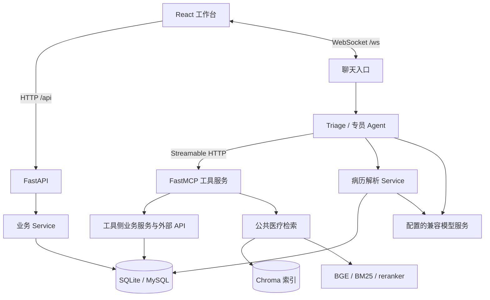
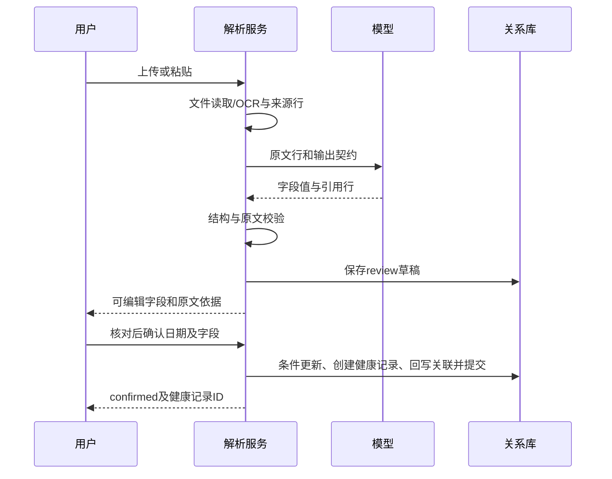
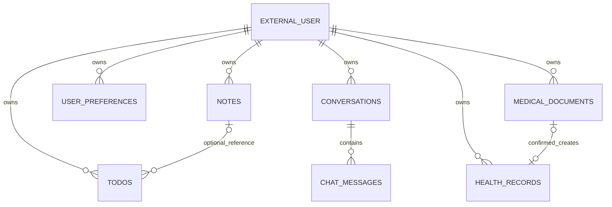

# Aide 项目实现与面试手册

核对日期为 2026-11-03，代码基线为 `codex/medical-record-parser` 分支的 `f038578`。本手册根据当前源码与已有验证记录编写，面向 AI 应用 / Agent 开发岗位。学习顺序是先掌握业务链路，再阅读对应函数，最后练习追问。测试数字均标注其原验证范围。

## 1. 先学会用两分钟讲清项目

Aide 是一个由 React 工作台、FastAPI API 和独立 MCP 工具服务组成的个人助手。用户可以聊天、管理笔记和待办、记录身体状况，并将门诊病历或出院小结解析为可核对的结构化字段。聊天由 OpenAI Agents SDK 编排，公共医疗知识通过本地 BGE、Chroma 和词法检索获取。病历解析复用后端服务，既能从页面上传文件，也能由专门的解析 Agent 处理聊天中粘贴的原文。

最适合展开的三个工程问题是任务路由、检索依据和写入一致性。复杂请求由 Triage 调用多个专员并汇总，医疗问答展示实际检索来源，病历字段必须能追溯到原文行，最后由用户确认后通过数据库事务生成健康记录。

面试介绍可以按下面的顺序组织。

1. 用户需求。把分散的聊天、个人信息和文档整理放进同一个工作台。
2. 系统结构。React + FastAPI + MCP，结构化事实进入关系库，检索内容进入向量索引。
3. 个人重点。选择自己确实理解和参与的 Agent 编排、混合检索、病历核对或工程验证展开。
4. 具体难点。例如重复确认、OCR 丢失否定词、旧索引返回过期笔记、令牌刷新造成退出。
5. 验证方式。说明哪些测试替换模型，哪些实际调用模型，哪些只验证连接。
6. 改进方向。认证授权、任务容量、独立效果评测和可复现依赖仍需要继续完善。

项目借鉴了 KnowResume 的文档解析分层思路，病历字段、证据校验、业务存储及交互在本项目实现。介绍时保留来源说明，个人职责按实际掌握程度表述。参见[病历设计与参考边界](medical-record-parser.md)。

## 2. 系统架构与三个执行入口



这是一个后端应用加独立工具进程的结构。API 和 MCP 可以访问同一个业务数据库，但各自拥有进程内对象和缓存。开发时前端端口从 3000 起分配，当前预览曾使用 3010，API 为 8000，MCP 为 8002。

| 执行入口 | 实际路径 | 核心区别 |
| --- | --- | --- |
| 页面业务操作 | 组件 → Axios → FastAPI 路由 → Service → SQLAlchemy | 用户明确执行一个操作，HTTP 返回结果 |
| 聊天 | Dashboard → WebSocket → Runner → Agent → 工具 → 流式返回 | 模型选择工具或交接对象，可产生多个执行事件 |
| 病历上传 | MedicalRecordParser → medicalDocumentAPI → MedicalDocumentService | 读取文件、结构化抽取与校验，先保存待核对草稿 |

必须分清三种标识。`user_id` 表示数据归属，`conversation_id` 表示长期业务会话，`connection_id` 表示这次 WebSocket 连接。刷新页面会产生新连接，历史会话仍可恢复。公开 UUID 不能代替用户归属检查。

源码入口见 [main.py](../backend/main.py)、[Dashboard](../ui/src/pages/Dashboard.tsx) 和 [WebSocket API](../backend/api/websocket_api.py)。

## 3. 技术栈、库与开发套件

### 3.1 后端主要依赖

后端依赖声明有一部分只写包名或版本下限。下表的精确版本来自本次可访问的共享 Python 环境快照，安装到另一台电脑时可能不同。应同时理解 `requirements.txt` 的声明与实际安装结果。

| 技术 / 本次环境版本 | 在项目中的用途 | 面试需要讲清的概念 |
| --- | --- | --- |
| Python 3.11 系列开发环境 | 后端、工具、离线评测 | 协程、线程池、进程内状态的边界 |
| FastAPI 0.141.1 | 路由、依赖注入、OpenAPI 文档、WebSocket | `Depends` 从请求获得身份，Pydantic 校验参数 |
| Starlette 1.6.0 | ASGI 基础、线程池适配、静态文件 | 同步 OCR 等阻塞操作需要离开事件循环 |
| Uvicorn 0.52.1 | 运行 ASGI 应用 | 应用生命周期、监听端口、进程与 worker |
| Pydantic 2.13.4 | 请求、模型输出、医疗资料和消息结构校验 | `Field` 限制、`Literal`、`model_validate`、`extra=forbid` |
| SQLAlchemy 2.0.51 | 关系模型、Session、事务与查询 | Engine 可共享，每个操作创建 Session，异常回滚 |
| SQLite / PyMySQL | 本地文件库 / MySQL 驱动 | 数据库可切换，SQLite 的单写者和锁竞争仍存在 |
| OpenAI Agents SDK 0.19.4 | Agent、Runner、handoff、function tool、Agent as tool | SDK 负责执行工具循环，业务规则在项目代码中 |
| LiteLLM 1.96.0 | Agent 使用兼容模型服务 | provider 前缀、模型名、base URL 与密钥的适配 |
| OpenAI Python SDK 2.53.0 | 病历抽取直接调用 `AsyncOpenAI` | JSON mode 与后续校验的分工、超时与重试 |
| FastMCP 3.4.6 / MCP 1.29.0 | 发布及发现工具，独立 HTTP 工具服务 | MCP 是协议，FastMCP 是服务端实现，Agent 是调用决策方 |
| ChromaDB 1.0.15 | 保存文本切片、向量和元数据 | collection、embedding 空间、过滤、持久化、可重建索引 |
| PyTorch 2.6.0 / Transformers 4.49.0 | 本地 CPU 推理 BGE 和 reranker | CLS pooling、L2 归一化、batch、推理模式 |
| jieba 0.42.1 / rank-bm25 0.2.2 | 中文分词和公共知识词法召回 | 稀有精确词、词频、逆文档频率、长度归一化 |
| pypdf 6.1.1 | PDF 文本、页数及加密检查 | 文字层抽取与扫描页识别的区别 |
| RapidOCR ONNX 1.4.4 | 可选本地图片 OCR | 输出文字和置信度，识别错误会传递到后续步骤 |
| PDFium 4.30.0 / Pillow 11.3.0 | 可选 PDF 转图及图片校验 | 渲染页、像素限制、资源释放 |
| python-jose / passlib[bcrypt] | JWT 签名校验、密码工具函数 | JWT 签名与加密不同，存在哈希函数不等于登录已使用逐用户密码 |
| requests / python-dotenv | 同步外部 HTTP 客户端、加载配置 | Session 复用、超时、重试、运行时配置 |

OCR 三个版本以独立的可选依赖文件为准，共享 Python 环境未直接安装全部 OCR 包，之前预览使用了工作区专用依赖目录。Alembic 列在依赖中，但当前启动主要使用 `metadata.create_all`，正式版本化迁移流程仍需补齐。

依赖证据见[后端声明](../backend/requirements.txt)、[可选 OCR 声明](../backend/requirements-medical-parser-ocr.txt)。

### 3.2 前端依赖

下表采用当前 `package-lock.json` 的解析版本。

| 技术 / 版本 | 实际用途 |
| --- | --- |
| React / React DOM 19.1.0 | 组件、局部状态、Effect、事件交互 |
| TypeScript 5.8.3 | 接口约束，编译期检查组件和请求调用 |
| React Router 7.6.3 | `/login`、工作台及受保护路由 |
| Redux Toolkit 2.8.2 / React Redux 9.2.0 | 全局登录状态、异步 thunk、类型化 selector 和 dispatch |
| Axios 1.10.0 | HTTP 请求、Bearer 拦截器、状态码与业务错误处理 |
| react-hook-form 7.60.0 | 登录表单的字段与提交管理 |
| Vite 7.0.4 / esbuild 0.25.6 | 开发服务、代理、构建及测试中编译真实 TS 模块 |
| Tailwind CSS 3.4.17 | 统一配色、布局、响应式和组件样式 |
| Radix Slot / Scroll Area | `asChild` 组合、滚动容器 |
| class-variance-authority / clsx / tailwind-merge | 按 variant 合成组件样式、处理 class 冲突 |
| lucide-react | 图标 |
| react-markdown 10.1.0 / remark-gfm 4.0.1 | 聊天 Markdown、表格、链接渲染 |
| PDF.js 5.6.205 | PDF worker 解码、canvas 页面预览及翻页 |
| ESLint / typescript-eslint / React Hook 与 Refresh 插件 | 代码检查、依赖检查、组件导出约束 |
| Node.js 24.19.0 的 `node:test` | 回归、SSR 渲染及本机接口联调 |

`openai`、`wavtools`、`react-syntax-highlighter` 虽列在前端依赖中，当前正式源码没有对应的直接导入证据。面试技术栈以已接入的功能为准。正式模型调用发生在后端。前端入口只对认证使用 Redux，聊天、解析与个人数据页面大量使用组件局部状态。

声明与锁定结果见 [package.json](../ui/package.json) 和 [package-lock.json](../ui/package-lock.json)。

## 4. 后端分层与启动机制

| 层 | 目录 | 职责 |
| --- | --- | --- |
| 应用入口 | `backend/main.py` | FastAPI、生命周期、路由注册、CORS、静态文件 |
| API | `backend/api/` | 身份依赖、参数校验、HTTP/WS 协议转换 |
| 编排 | `backend/agent/` | Agent 声明、路由、用户上下文、会话历史 |
| 业务 | `backend/service/services/` | 笔记、待办、偏好、会话、健康记录和病历事务 |
| 业务模型 | `backend/service/models/` | SQLAlchemy 表和字段 |
| 基础设施 | `backend/core/` | 数据库、向量库、HTTP、认证和连接管理 |
| 工具 | `backend/mcp-serve/` | 用 MCP 暴露业务与外部能力 |
| 医疗检索 | `backend/medical/` | 数据治理、切片、检索、重排及评测 |
| 病历读取 | `backend/medical_parser/` | 文档转原文、模型抽取、证据校验 |

`lifespan` 启动服务，创建心跳任务和缓存清理任务。结束时取消后台任务、关闭数据库和服务实例。直接运行 API 时，它可以启动 MCP 子进程。Windows 启动脚本会先核对端口和进程归属，启动 MCP，再令 API 使用 `AIDE_EXTERNAL_MCP=true`，避免重复创建工具服务。

ServiceManager 共享 Engine、向量客户端、认证服务和具体 Service，用户与令牌缓存的默认期限为 15 分钟。PerformanceManager 共享 Agent 配置，按用户缓存 SessionManager 和默认 10 分钟的用户上下文。共享 Agent 对象可以节省初始化，但用户历史和可变上下文必须隔离。

这些共享对象都在当前进程内。启动多个 API worker 后，缓存、连接映射与解析信号量会分别存在，容量和一致性需要重新设计。

源码见[服务管理器](../backend/service/service_manager.py)、[性能管理器](../backend/core/performance_manager.py)、[启动脚本](../启动Aide.ps1)。

## 5. Agent 编排具体怎样实现

### 5.1 Agent 是配置与能力的组合

项目通过 `Agent[PersonalAssistantContext]` 指定名称、模型、动态 instructions、工具及允许交接的 Agent。底层模型通过 `LitellmModel` 创建，兼容服务的非标准模型名会按需要添加 `openai/` provider 前缀。

| Agent | 主要能力 | 工具与调度方式 |
| --- | --- | --- |
| Triage | 理解用户意图并分发任务 | 六个专员 handoff，加天气、新闻、食谱的 `as_tool` |
| Weather | 当前天气和预报 | MCP weather 前缀工具，指令含上海时区当前日期 |
| News | 按地点或主题查新闻 | MCP news 前缀，要求检查文章日期及来源 |
| Recipe | 菜谱和食材 | MCP recipe 前缀 |
| Personal Assistant | 用户、偏好、笔记、待办 | MCP user 前缀 |
| Medical Health | 带来源的健康知识及健康记录 | MCP medical、health 前缀，较低温度 |
| Medical Record Parser | 解析用户提供的病历原文 | 本地 `@function_tool parse_medical_record` |
| Conversation Title | 用早期历史生成短标题 | 单独 Runner 调用 |

### 5.2 handoff 与 as_tool 的选择

单一领域任务可以 handoff，活动 Agent 随之改变。跨领域只读任务，例如“查明天天气和最近新闻，再给出出行参考”，由 Triage 调用 `consult_weather_agent` 和 `consult_news_agent`，收回结果后合并回答。专员之间没有互相 handoff 的图边。

这样做是为了保留复合任务的汇总位置。只 handoff 到天气专员时，后续新闻子任务可能被遗漏。`parallel_tool_calls=True` 表示模型设置允许并行工具调用，实际调用顺序仍受模型输出和 SDK 执行影响，不能直接当作固定并行工作流。

### 5.3 上下文与历史

`PersonalAssistantContext` 包含用户 ID、名字、位置、偏好、待办及会话信息。动态 instructions 可以从 `RunContextWrapper` 读取这些已获取的信息。AgentSession 从 SQL 加载最近最多 100 条消息，恢复为 `input_items`，运行结束后保存新消息与当前 Agent 状态。

11 月 3 日进一步检查发现，当前聊天收尾只传最后一轮问答给 `save_state`，其 `_state.update(state)` 会覆盖已加载的 `input_items`。因此连续聊天不能按“始终保留最近 100 条”理解，这里需要修复历史合并。详细记忆机制见第 19 节。

最近 100 条是消息数量限制。它没有精确控制 token 总量，长病历或较长工具结果仍可能占用很大上下文。生产改进可以按 token 预算裁剪、保留关键原文，另做可追溯摘要。

### 5.4 解析 Agent 的约束

`parse_medical_record` 从运行上下文取 `user_id`，将完整原文交给与 HTTP 页面共用的 MedicalDocumentService，返回草稿 ID、字段及提示。文件上传仍由页面完成。解析 Agent 没有确认入库工具，用户需要在病历工作区核对后点击保存。

这里有确定的工具边界，也有依赖指令的行为边界。例如要求模型完整传入原文属于指令约束，不能代替输入校验和回归测试。SDK 中存在 Guardrail 类型、页面存在 guardrail 面板，也不能据此声称当前每个 Agent 都挂载了完整的输入输出安全检查。

核心实现见[Agent 管理器](../backend/agent/personal_assistant_manager.py)和[会话适配](../backend/agent/agent_session.py)。

## 6. MCP 与外部能力

FastMCP 在本机 8002 的 `/mcp` 发布 Streamable HTTP 服务，并使用 stateless HTTP 模式。服务器导入 weather、news、recipe、user_data、medical、health 子工具组，带前缀组成总工具集。Agent 侧使用 `MCPServerStreamableHttp` 连接，按专员名称过滤可见工具。

普通函数工具由 SDK 根据 Python 类型和描述建立调用契约。MCP 进一步提供跨进程的发现与调用协议。模型负责提出工具和参数，真正的数据库操作、HTTP 请求、参数处理发生在服务端 Python 函数里。

| 工具组 | 封装的实现 |
| --- | --- |
| weather | Open-Meteo 当前天气、日预报、小时预报 |
| news | TheNewsAPI 普通新闻、头条、关键词搜索 |
| recipe | TheMealDB 名称、食材、类别、地区、详情和随机菜谱 |
| user_data | JSONPlaceholder 用户目录，以及本地偏好、笔记、待办 Service |
| medical | 医疗问题范围判断、检索、来源和诊断信息 |
| health | 健康事实新增、查询、修正及时间解析 |

外部客户端复用 `requests.Session`。通用客户端默认超时 10 秒，最多尝试 3 次，连接/超时按指数间隔等待，429 使用固定等待。它是同步客户端，如果在异步请求链中直接执行，会占用对应线程或阻塞事件循环，必须结合具体调用路径分析。

工具过滤能减少模型看到的能力，但不能当作数据授权。若工具参数允许模型传 `user_id`，服务端仍需把请求身份与资源归属绑定。当前 MCP 按本地受信工具进程使用，部分个人数据写工具仍需加强这一层约束。

实现见[MCP 入口](../backend/mcp-serve/mcp_server.py)、[外部客户端](../backend/remote_api/)和[通用 HTTP 客户端](../backend/core/http_core/client.py)。

## 7. 聊天与 WebSocket 的完整执行链

1. Dashboard 用登录用户和令牌创建 WebSocketService，经同站点 `/ws` 代理连接后端。
2. 后端验证令牌并检查请求用户 ID 与令牌身份相符，初始化 Agent 管理器，加入用户房间，发送连接成功消息。
3. 前端发送 `chat` 消息，将所选会话及 general/medical 模式放入 metadata。
4. 聊天处理器创建异步任务，取得用户上下文与会话；缺少会话 ID 时生成新 ID，先保存用户消息。
5. `Runner.run_streamed(agent, input=input_items, context=context)` 启动推理，读取 `stream_events()`。
6. token delta 更新流式文本，MessageOutputItem 形成完整消息，工具调用、工具结果、Agent 切换形成执行事件。
7. 响应队列负责向连接发送，数据库队列负责保存最终输出及医疗引用 metadata。
8. 发送 completion 包，页面结束加载，后续可以通过会话 API 重开历史。

前端还需要兼容直接 ChatResponse 与 completion 内嵌 `final_response`。`chat-payload.ts` 过滤异常来源对象、规范化时间戳，`api-errors.ts` 将 HTTP 状态保留在 ApiError 中，避免把服务端错误当成登录失效。

WebSocketService 复用未完成的连接 Promise，移除旧监听器，忽略旧 socket 的迟到回调，令牌改变时换连接。非认证异常可以退避重连，最多五次；只有收到后端就绪消息才重置重试计数。

后端连接管理器有房间、用户连接映射和心跳任务，默认心跳间隔 30 秒、连接超时 90 秒。长时间空闲的实际行为还应核对前后端心跳协议，11 月的真实联调只验证了连接与就绪消息。

当前聊天任务及两个流式队列缺少完整的全局容量和背压控制，连接映射也在进程内。同一会话的多请求排序、客户端取消、断线续传、多实例广播和长任务恢复都是可展开的改进题。`asyncio.create_task` 让出执行机会，不能消除其中的同步数据库及网络阻塞。

实现见[聊天处理器](../backend/api/websocket_api.py)、[连接管理器](../backend/core/web_socket_core/manager.py)、[前端连接](../ui/src/lib/websocket.ts)。

## 8. 医疗 RAG 从数据到回答

### 8.1 数据进入索引前的治理

公共知识文档 schema 包含 `doc_id`、version、title、topic、audience、原始来源 URL、发布日期、正文，以及来源哈希、定位、采集日、审核状态、复核日、许可及适用范围。

默认发布集合只允许未撤回、未过复核期的中文 `clinician_reviewed` 文档。开发 research 模式放宽到 `source_checked`，独立 preview 使用 hash embedding。源码实现了这些门槛，但实际库是否有满足门槛的资料要看当时的数据和配置。

资料 registry 另行记录商业使用、再分发、翻译、RAG、模型训练等权利。`OPEN` 与明确的 RAG 权利才允许进入可回答名单。来源核验、许可检查和临床审核是不同条件。MedlinePlus、USDA、Huatuo 等导入/试验脚本的存在，也不能直接推出全部资料已进入正式中文回答索引。

### 8.2 切片和向量

医疗正文按标题层级和句子边界切片，默认最多 600 个字符，重叠最多 80 个字符，重叠不跨章节。索引文本包含文档标题和章节路径。切片 ID 根据文档 ID、版本、章节、位置及内容计算哈希，同步时撤下旧版本和失效文档。

BGE-small-zh-v1.5 产生 512 维向量。查询添加检索指令，文档不添加。Transformers 使用最后隐藏层 CLS 向量并 L2 归一化，Chroma 使用 cosine 空间。模型以固定 revision 下载，运行时核对权重 SHA256，集合 metadata 也记录 embedding 和索引版本，避免混用向量空间。

### 8.3 双路召回、融合和重排

默认候选上限为 dense 24、词法 24，随后最多选择 8 个交给 reranker。词法通道由配置控制，在当前 BGE research 路径开启条件明确。正式发布集合与 preview 的路径不能直接套用相同效果结论。

加权 RRF 使用排序位置。

```text
fusion(d) = 0.60 / (60 + dense_rank(d))
          + 0.40 / (60 + lexical_rank(d))
未出现在某一路时，该路贡献为 0。
```

向量距离和 BM25 原始得分量纲不同，RRF 用名次避免直接相加。预选还保留 dense 5 席和 lexical 3 席，再补齐，避免只有词法通道命中的精确答案被全部挤掉。

BGE-reranker-base 将 query 和 passage 作为一对输入 cross encoder，对输出 logits 做 sigmoid，按得分重排。运行时默认 batch 8、max length 256，并串行共享 CPU 推理。相关度分数用于排序，不代表经过校准的医学正确概率。

重排成功时使用绝对下限 0.05 和相对下限 `best × 0.35`，兼顾排名靠前的词法候选。重排不可用或输出不合法时回到混合排序及距离门槛，并记录 fallback 状态。每篇文档默认最多选 2 个块，避免一个长文独占上下文。

### 8.4 检索结果怎样变成回答

MCP `medical_search` 接受问题及用户明确说过的追问事实，先检查支持的人群和地域、急症表达和个体临床决策范围，再检索。返回 `grounded`、`not_covered` 或 `unavailable`，以及 E1、E2 等证据标识、来源、内容和 usage_scope。

Medical Agent 据此生成回答。`medical_response_metadata` 从真实工具结果提取来源和覆盖状态，持久化时去掉检索问题、证据正文及分数。前端历史消息也能显示来源卡片。

引用关联能证明检索到了哪些材料。回答每一句是否被证据蕴含仍需专门评测。`answer_audit.py` 目前是离线数量词审计，只检查回答中的部分数字单位是否在证据出现。急症和范围规则也只是有限表达规则，不能替代临床判断。

### 8.5 缓存与评测

检索缓存默认 60 秒、128 条，key 包含规范化查询、preview 标记、limit 和集合数量，命中结果深拷贝。词法源缓存也有 TTL。同条数资料替换和审核日期跨日等情况需要考虑失效版本，现有 key 并未表示所有内容变化。运行日志主要记录文档 ID、耗时、候选量和降级状态，避免保存用户问题。

已有冻结回归集记录 Recall@1 为 0.933、Recall@5 为 1.000、MRR 为 0.956、nDCG@5 为 0.967。它的失败项曾用于修正规则，复习时应称锁定回归集。检索指标与生成答案的准确性、临床可用性仍需分别评测。

| 指标 | 含义 |
| --- | --- |
| Recall@K | 先将切片结果按 doc_id 去重，每题计算前 K 项覆盖的相关文档比例，再对 supported 题平均 |
| MRR | 首个相关文档排名倒数的均值，当前实现从至多 20 个检索结果中的去重文档寻找首个匹配 |
| nDCG@K | 当前标注采用二元相关性，按位置折扣后除以理想排序得分，具体实现见 evaluate.py |
| 拒绝 / 降级行为 | 无资料、超范围、工具故障时是否正确报告 |
| 延迟与费用 | 分别记录召回、重排、模型首 token、完整请求和工具调用成本 |

源码见[知识库](../backend/medical/knowledge_base.py)、[embedding](../backend/medical/bge_embedding.py)、[reranker](../backend/medical/bge_reranker.py)、[工具](../backend/mcp-serve/medical_tools.py)和[评测记录](../backend/medical/eval_report_validation_v1.md)。

## 9. 病历解析的完整实现

### 9.1 约束和文件读取

原始文件最多 10 MiB，PDF 最多 12 页，提取文字最多 40,000 字符，图片最多 2,000 万像素。HTTP 上传使用原始请求体逐块读取，在超限时立即拒绝，并将客户端文件名缩为 basename。

| 格式 | 处理方式 |
| --- | --- |
| TXT | `utf-8-sig` 解码，兼容 BOM，按非空行构建来源 |
| DOCX | 检查 ZIP 大小与条目数，读 `word/document.xml`，按段落顺序包含表格文字 |
| 原生 PDF | 检查文件头、加密、页数，用 pypdf layout 模式读取文字层 |
| 扫描或含图 PDF 页 | PDFium 逐页渲染，控制像素，再送本地 OCR |
| PNG / JPG / JPEG | Pillow 校验图片和像素，RapidOCR 输出文字与置信度 |

DOCX 对含嵌入图片的文档明确拒绝并要求转 PDF，避免静默遗漏图片内容。PDF 某页有图、文字过少或出现替换字符时采用 OCR。这是保守启发式，仍会有复杂版式、误识别和性能代价。

OCR 引擎懒加载并以线程锁串行复用 ONNX session。文件读取和 OCR 通过 `run_in_threadpool` 执行。解析 Service 使用 `threading.BoundedSemaphore(2)`，容量满时返回 429。这是单 Service 实例的容量保护，跨进程部署时需额外队列或分布式容量机制。

### 9.2 统一来源与模型输出

所有格式先变成统一结构。

```json
{"id":"p1-l3","page":1,"text":"初步诊断：上呼吸道感染（待排）。","method":"pdf","confidence":null}
```

模型返回文档类型与字段，每个字段含 `value` 和 `line_ids`。当前有 16 个字段，覆盖姓名、性别、年龄、机构、科室、就诊/入院/出院日期、主诉、现病史、既往史、过敏、检查、原文诊断、诊疗用药、医嘱。

抽取使用 `AsyncOpenAI.chat.completions.create`，JSON object 模式、temperature 0、最多 6000 输出 token，90 秒超时，SDK 自动重试关闭。解析专用配置优先，缺省复用 `OPENAI_*`。模型截断、无效 JSON 和调用故障返回可控错误。

JSON mode 约束输出形态，Pydantic 检查字段结构，`ground_result` 再检查来源事实。temperature 0 会减少随机性，但不能保证完全确定或消除幻觉。

### 9.3 原文依据校验

1. `line_id` 必须存在，引用列表去重。
2. 非空字段必须有证据，去除空白后的值必须出现在引用行拼接文本中。
3. 临床字段检查“否认、未见、待排、疑似、可能”等限定词是否被遗漏。
4. 不满足校验的值清空并产生提示，不把缺失信息写成“无”。
5. 来源 OCR 置信度低于 0.85 时标记 `needs_review`。

这套校验对逐字摘录和限定词丢失有效，但文字在原文出现不一定代表字段归类正确，否定词的简单匹配也可能过度保守。尤其 OCR 已把原件识别错时，后续校验面对的也是错误文本，所以前端保留原件预览和人工核对。

### 9.4 草稿、人工确认与幂等事务

解析成功先写 `medical_documents`，`status=review`。原结果存 `result_json`，之后人工字段和归属日期存 `reviewed_json`。SHA256 用于指纹，表里没有指纹唯一约束，因此重复上传仍可能生成不同草稿。

确认时先按用户和 public ID 查草稿。若已确认，直接返回原结果。尚未确认则执行条件更新。

```sql
UPDATE medical_documents
SET status = 'confirming'
WHERE id = :id AND status = 'review';
```

只有影响 1 行的请求继续创建 HealthRecord，使用 `flush` 获得记录 ID，然后回写 `health_record_id`、人工修改内容和 `status=confirmed`，最后同一事务 commit。异常会回滚，中间状态随事务回滚。竞争请求需要重新读取已确认结果，或收到 409 后稍后重开。

幂等性覆盖同一草稿的重复确认，不等于多次上传相同原件自动去重。删除解析记录目前也不会自动删除已经确认生成的健康记录。原文件没有进入对象存储，数据库保存的是提取原文及字段，刷新后重开可以恢复这些内容，原始 PDF/图片需要重新选择。



实现见[文件读取](../backend/medical_parser/documents.py)、[抽取及校验](../backend/medical_parser/extractor.py)、[原子确认](../backend/service/services/medical_document_service.py)、[HTTP 接口](../backend/api/medical_document_api.py)。

## 10. 数据库设计与一致性

### 10.1 业务表与字段

所有业务模型继承 BaseModel，公共字段为整数自增 `id`、`created_at`、`updated_at`。当前业务用户资料来自外部目录和开发测试账号路径，仓库并未定义完整的本地账号密码表。

| 表 | 主要业务字段 | 关联与查询重点 |
| --- | --- | --- |
| `user_preferences` | user_id、category、preferences JSON 文本、last_updated | `(user_id, category)` 唯一，每人每类一份偏好 |
| `notes` | user_id、title、content、tag、status、last_updated | 单值 tag、状态过滤，含 `(user_id,status)` 索引 |
| `todos` | user_id、title、description、completed、priority、note_id、due_date、completed_at | 可逻辑关联笔记，按用户/完成状态、用户/优先级建索引 |
| `conversations` | user_id、唯一 id_str、title、description、status、last_active | 自增主键与公开 UUID 分离 |
| `chat_messages` | conversation_id、conversation_id_str、sender_type、sender_id、content、message_type、status、extra_data、reply_to_id | 引用与覆盖状态存 extra_data，历史按会话和时间查询 |
| `health_records` | user_id、observed_at、time_precision、record_type、title、summary、details_json、source、source_conversation_id、source_message_id、confidence、status | 区分事实发生时间与写入时间，按用户和日期查询，支持逻辑删除 |
| `medical_documents` | public_id、user_id、filename、source_sha256、status、result_json、reviewed_json、health_record_id | public_id 唯一，用户与创建时间复合索引 |

HealthRecord 的类型包括 symptom、vital、medication、visit，来源包括 conversation、manual、document。`time_precision` 区分 minute、day、unknown，避免把“某天发生”伪装成精确时间。`confidence=user_confirmed` 表示用户核对，是业务状态。

这些表大多通过业务 ID 逻辑关联，没有全面使用数据库外键。删除会话时 Service 在一个事务内删除消息和会话，API 再清除对应内存缓存。相关联的其他业务对象需要明确各自的保留策略。



图表示业务关系，EXTERNAL_USER 是概念实体，图中的连线不代表已经创建外键约束。各字段的正式定义见[业务模型目录](../backend/service/models/)。

### 10.2 SQL、Chroma、JSON 各管什么

SQL 保存可编辑的业务事实和事务状态，Chroma 保存可重建的检索索引。公共医疗知识、个人笔记与普通向量模块具有各自的数据路径和模型约定，不能因同用 Chroma 就混成一个集合。

JSON 文本适合解析字段、偏好和来源这类变化较多的结构，便于先保留完整结果。代价是数据库内字段约束和统计查询较弱。如果以后需要高频按过敏原、药名等查询，应在业务定义和数据质量明确后设计结构化表或索引。

SQLAlchemy 的 Engine 管理连接，`get_session()` 创建短期 Session，异常 rollback，最终 close。具体写操作显式 commit。SQLite 配置 `check_same_thread=False` 只允许跨线程使用连接，不会让同一个 Session 自动变成线程安全。

MySQL 连接池默认 size 5、max overflow 10、timeout 30 秒、recycle 3600 秒，并启用 pre-ping。SQLite 方便单机演示，写入竞争和长事务会限制吞吐。`create_all` 主要创建缺失表，不能代替 ALTER/数据回填/版本回滚的迁移方案。

### 10.3 面试要会解释的索引

典型健康查询是 `WHERE user_id=? AND observed_at>=? AND observed_at<? ORDER BY observed_at DESC`，与 `(user_id, observed_at)` 索引相配。只建单列索引并不等于满足所有组合过滤和排序，仍需看执行计划。

会话列表过滤用户并按活动时间排序，当前存在用户和时间等单列索引，可以进一步评估复合索引。消息历史也可以评估 `(conversation_id_str, created_at, id)`，兼顾分页和同时间戳稳定排序。UUID 降低直接枚举的便利程度，实际授权还要检查 owner。

## 11. 个人数据模块与笔记搜索

### 11.1 CRUD 的具体组织

笔记、待办、偏好、会话和健康记录各有模型与 Service。API 接受请求、检查当前用户、调用 Service 并返回响应。笔记支持标题/内容检索、标签和状态；待办支持优先级、截止时间和完成时间；健康记录支持日期范围、每日计数、详情与修正。

普通笔记/待办的部分 Service 方法只接收对象 ID，API 在调用前做归属检查。工具侧如果复用这些方法，也需要补同等授权检查。不能把某个 HTTP 入口通过用户隔离测试，外推为所有工具写入口均安全。

### 11.2 新旧笔记搜索路径

`NOTES_LOCAL_SEARCH=true` 且 SQLite 可用时启用 NoteSearchIndex。默认开关是 false，未启用时仍走已有向量/文本路径及降级。笔记本地搜索和公共医疗检索共用 BGE 实现，但召回流程、切片和索引一致性机制各自实现。

本地搜索同时使用 SQL 精确匹配、SQLite FTS5 词法搜索与 BGE 语义候选。FTS OR 检索后要求至少覆盖一半去重非停用查询词，减少只有通用词重合的误召回。最终按笔记聚合、融合，并再次回查关系库验证归属、筛选条件和 revision。

### 11.3 事务任务表如何解决双写

SQLite trigger 在 INSERT/UPDATE/DELETE notes 的同一个事务内写入 `note_index_jobs`。这让“业务已提交但索引任务丢失”的窗口缩小。后台 worker 通过 lease 抢占任务，读取最新笔记并切片，向 Chroma upsert，重新核对 SQL revision，再更新 FTS 和 `note_index_state`，清理旧切片和任务。

| 索引辅助表 | 用途 |
| --- | --- |
| `note_index_jobs` | note_id、user_id、attempts、available_at、lease_until、error_type，支持延迟与失败重试 |
| `note_index_state` | 当前已发布的 note_id、user_id、revision |
| `note_chunks_fts` | FTS5 虚拟表，保存切片正文、分词及版本信息 |

revision 是用户、ID、标题、内容、标签、状态的哈希。旧索引即使暂未删干净，读取时回查发现版本或归属不符就丢弃。修改触发器会再次排入最新任务，索引可以重建。

任务 lease 默认 300 秒，最多重试 5 次后保留待处理状态，需要管理和修复入口。此机制实现最终一致性，更新后可能短暂只命中精确/词法通道。它也需要继续验证多进程崩溃与锁竞争。

入口也需要区分。页面搜索可进入本地混合检索，当前 MCP 的 `user_search_notes` 调用的是 `NoteService.search_notes` 文本查询，尚未接通同一套本地 BGE 混合搜索。

### 11.4 切片与容量保护

笔记切片保存正文 start/end，默认 tokenizer 预算 480 token，标题前缀另有预算，尽量沿标题、句子、代码块和表格分割。每次变更产生新的内容 revision。

语义查询使用一个线程和一个容量槽，1.2 秒超时后回退，避免堆积无限推理。超时不意味着底层 CPU 工作已经停止，槽必须在工作真正完成后释放。已有 1000 条合成笔记的温模型 P95 为 42.76ms，但该数字来自特定服务函数基线，排除了 HTTP、排队、鉴权和冷启动，且部分并发请求会降级。

实现与证据见[本地索引](../backend/service/services/note_search_index.py)、[切片](../backend/service/services/note_chunks.py)、[规模与困难样例](note-search-scale-validation.md)。

## 12. 前端逐模块阅读

| 模块 | 负责什么 | 需要理解的实现点 |
| --- | --- | --- |
| `main.tsx`、`App.tsx` | Provider、Router、认证初始化和全局提示 | 挂载顺序、Effect 清理、错误边界 |
| `Login.tsx` | 表单、登录结果与跳转 | react-hook-form、异步提交和错误反馈 |
| `ProtectedRoute.tsx` | 页面访问控制 | loading、token、user、isAuthenticated 的关系 |
| `authSlice.ts`、`auth.ts`、`useAuthInit.ts` | 登录存储、恢复、验证、后台刷新 | localStorage 与 Redux 同步，旧刷新请求失效 |
| `Dashboard.tsx` | 工作台区域、聊天、当前会话、解析入口 | 组件局部状态、异步回调依赖、页面切换 |
| `ConversationList.tsx` | 分页会话列表、选择和删除 | 请求状态、避免重复加载及迟到响应 |
| `Chat.tsx`、`ChatMarkdown.tsx` | 消息、流式状态、来源卡片 | Markdown、来源结构检查与安全链接 |
| `websocket.ts`、`useWebSocket.ts` | 连接与事件订阅 | pending Promise、凭据轮换、监听器注销和退避 |
| `chat-payload.ts`、`types.ts` | 将外部载荷转成页面数据 | `unknown` 校验，秒级时间戳转换与历史排序 |
| `apiService.ts`、`api-contracts.ts` | 普通 HTTP 和响应类型 | 不同历史接口返回包裹结构的兼容 |
| `medicalDocumentAPI.ts` | 病历请求 | raw file body、长解析超时、确认字段 |
| `medical-record-parser.tsx` | 上传、样例、核对、历史重开和确认 | busy 状态、原件 object URL、日期建议 |
| `medical-parser-field.tsx` | 单项值、状态和来源选择 | 点击字段关联原文行、人工修改 |
| `medical-pdf-preview.tsx` | PDF canvas 和翻页 | 动态加载、worker、字体/CMap/WASM、任务取消 |
| `person-data-panel.tsx` 及三个数据面板 | 笔记、待办、健康日历 | 筛选、CRUD、日期范围与刷新 |
| `useLatestRequest.ts` | 请求代数 guard | 仅采用当前请求结果，卸载时失效 |
| `ui/`、`useToast.ts`、`index.css` | 按钮、弹窗、Toast 和设计变量 | 可组合样式、定时器清理、响应式 |
| Agent/Runner/Context/Guardrail 面板 | 展示编排事件和上下文 | 展示字段与真实运行保护措施的区别 |
| `mockData.ts`、`seat-map.tsx`、`WebSocketTester.tsx` 等 | 演示与调试配套 | 先查入口引用，避免把遗留组件算入正式流程 |

`useLatestRequest` 解决已发请求的返回顺序问题，但不取消服务端工作，也不自动解决所有旧闭包触发的新请求。类型检查能约束调用代码，接口返回的运行时结构仍需校验。

PDF 原件用浏览器 object URL 预览，组件卸载或文件替换时 revoke；PDF.js 取消渲染任务并释放加载对象。worker、中文 CMap、标准字体和 WASM 从同站点提供，避免只复制一个 JS 文件后中文预览失败。刷新重开时的原文件恢复边界见病历章节。

前端采用同站点 `/api` 与 `/ws`，开发由 Vite 代理到 API。构建得到 `ui/dist`，后端静态服务期待 `backend/static`，实际发布还需要部署步骤处理产物和反向代理。

实现见[前端源目录](../ui/src/)、[PDF 预览](../ui/src/components/medical-pdf-preview.tsx)、[Vite 配置](../ui/vite.config.ts)。

## 13. 认证、权限与当前限制

登录接口接受用户凭据，返回 JWT 和用户信息，同时设置 Cookie。前端保存令牌，Axios 请求带 Authorization。后端优先读 Bearer，再读 Cookie 和适用入口的查询参数。JWT 用 HS256，默认访问有效期 7 天，签名保护内容完整性，payload 本身可解码。

前端后台刷新适配后端的 `token` 返回字段，成功时更新 Redux 与 localStorage。请求 ID 防止退出后迟到的刷新恢复旧会话。临时 503 且旧 token 仍有效时保留登录，认证失败或实际过期时清理。刷新属于后台请求，避免用全页面 loading 卸载工作台。

必须能坦诚讲出以下不足及修复方向。

| 当前代码中的问题 | 为什么重要 | 可实施的下一步 |
| --- | --- | --- |
| 固定密码认证仍存在，逐用户密码哈希未完整接入 | 演示身份无法满足生产账户隔离 | 实际逐用户哈希或身份提供方，开发演示整体受开关约束 |
| JWT 默认密钥可回落到示例值，刷新缺少完整撤销机制 | 部署配置错误、退出撤销能力不足 | 启动时验证密钥，短期 access token 与受控刷新/撤销 |
| 部分管理接口仅要求已登录，角色检查不完整 | 登录身份不能代表管理员权限 | 权限依赖、角色或能力检查和越权回归 |
| MCP 部分数据工具信任参数中的用户 ID | 模型生成参数仍属于不可信输入 | 请求身份绑定上下文，写工具统一验证 owner |
| JWT 出现在 WebSocket 查询、前端存在 localStorage 凭据 | URL 日志和 XSS 都需要关注 | 缩短令牌寿命、受控日志、合理 Cookie/一次性连接凭据 |
| 身份缓存期限未完整表达 JWT 到期与撤销 | 缓存命中可能落后于真实身份状态 | TTL 不超过 exp，建立失效策略 |
| 队列和任务容量、跨实例状态不完善 | 高并发、重启和断网时难保证体验 | 有界队列、取消、会话串行、任务恢复和共享连接路由 |

病历入口在 owner 来源、字段约束和错误不回显输入上做了较明确的保护。全站仍需要统一验证认证、授权、日志和部署配置。隐私存储当前使用本地数据库和提取原文，生产应另行设计保留期限、访问审计、备份及删除策略。

源码见[认证](../backend/core/auth_core/auth.py)、[依赖与权限](../backend/core/auth_core/middleware.py)、[认证接口](../backend/api/auth_api.py)。

## 14. 测试怎样讲，数字怎样使用

| 已有证据 | 可以说明的事实 | 仍要区分的范围 |
| --- | --- | --- |
| 2026-11-02 前端 22 项回归 | 认证、刷新异常、迟到请求、静态渲染及连接行为通过 | 模拟 transport 和 SSR，未操作浏览器 |
| 同日 11 个本机联调子场景 | 实际登录、刷新、数据读取、病历重开、422/401 和 WS welcome 通过 | Node 汇总含外层共 12，未执行模型回答 |
| 同日前端 lint、类型与构建 | lint 0 错误 0 警告，TS 和构建通过 | 构建仍提示浏览器兼容数据较旧 |
| 2026-10-15 后端全量记录 | 100 项中 98 通过、2 项因未安装归档而跳过 | 旧日期记录，本手册未重新全跑 |
| 2026-10-10 至 14 的文件验收 | 6 种扩展名、8 类场景完成上传、OCR/读取、真实模型、核对、保存和重开 | 同一虚构样例，不是复杂病历质量基准 |
| 医疗与笔记检索评测 | 已有固定题集及受控规模/故障检查 | 区分开发集、看过的回归集、外部盲测及端到端耗时 |

主要测试入口为 `backend/tests/test_medical_parser.py`、`test_agent_coordination.py`、`test_conversation_deletion.py`、`test_note_local_search.py`、`test_medical_grounding.py`、`test_answer_audit.py` 及前端两份测试文件。

```powershell
# 在 ui 目录运行
npm run check
npm run build

# 在已配置后端运行时的 backend 目录运行
python -m unittest discover -s tests -p "test_*.py"
```

病历格式完整矩阵还要求安装 OCR、生成合成文件并设置 `MEDICAL_PARSER_TEST_FIXTURES`。真实模型和外部 API 测试另行配置，不能只看命令退出码就报告所有场景已覆盖。

证据见[最新前端记录](frontend-quality-validation-20261102.md)、[病历格式记录](medical-record-parser-validation.md)、[笔记规模记录](note-search-scale-validation.md)。

## 15. 高频面试追问与回答要点

### 15.1 为什么使用多 Agent

不同领域有不同工具、上下文和回答约束。专员缩小每次决策的工具范围，Triage 负责路由与复合任务汇总。代价是额外模型调用、延迟、错误传播和更复杂的状态管理。如果一个请求用确定性函数即可完成，可以直接走 Service。

继续追问时，画出天气/新闻 as_tool 与个人数据 handoff 两条路径，解释控制权最终在哪里。

### 15.2 怎么判断工具调用成功

区分模型接受请求、SDK 成功执行、外部服务成功响应和业务操作实际提交。新闻模型拒绝与新闻 API 失败分别处理。病历创建草稿成功也只表示到了待核对阶段，确认事务完成后才表示健康记录已生成。

### 15.3 Prompt injection 怎样处理

病历 prompt 声明输入是数据并禁止执行文中指令，模型输出还经过 schema、行号和原文检查。工具能力按 Agent 筛选，解析 Agent 只有创建草稿能力。剩余风险需通过服务端身份绑定、工具参数约束、可执行能力收敛和注入样例测试持续验证。

### 15.4 为什么选 BGE，而不是直接把资料交给大模型

资料规模增长后，全部塞进上下文会增加 token、噪声和费用。BGE 先做语义召回，词法补精确词，cross encoder 精排少量候选。本地模型也减少检索对远程 embedding 的依赖。具体优劣应通过当前数据的消融实验比较。

### 15.5 BM25 与 embedding 各自会错在哪里

BM25 可能漏掉改写和同义表达，embedding 可能把同主题但不回答问题的段落排得很高。两者融合补候选，再用重排和范围过滤降低错误。分词、领域词典和困难负例同样重要。

### 15.6 为什么使用 RRF 和候选配额

两个检索器的原始分数量纲不同，用排序位置融合更直接。0.6/0.4 加权会偏向 dense，在候选上限很小时纯词法精确答案可能被排掉，所以预留 5/3 的候选席位。参数是当前工程选择，效果需要持续评测。

### 15.7 embedding 与 reranker 有什么区别

embedding 可离线编码文档，查询时做近邻检索，速度适合大候选集。reranker 同时读问题和候选正文，相关性判断更细，但每对都要推理，所以只处理少量候选。项目向量是 512 维，reranker 输出单个相关度分数。

### 15.8 chunk 为什么这样切

医疗材料按标题和句子，保留章节路径；笔记按 tokenizer 预算和正文偏移。前者 600 字符、80 重叠，后者 480 token 的预算不能混淆。过大易混入无关信息，过小会丢语境，重叠影响召回也增加索引量。

### 15.9 RAG 如何降低幻觉

检索限定来源和当前审核状态，工具明确覆盖状态，回答展示实际引用。仍需验证生成内容是否被证据支持，尤其数字、条件、适用人群和否定关系。无命中时应承认覆盖不足，不能用空引用伪装有依据。

### 15.10 数据变更时怎样避免查到旧内容

公共知识用文档版本、切片内容哈希和同步撤回。笔记用同事务任务表、内容 revision 和查询后回查。缓存失效还需考虑同条数更新和复核日期变化。SQL 是笔记事实源，向量库可以重建。

### 15.11 两次点击保存为什么不会写两条

同一草稿通过 `WHERE status=review` 的条件更新竞争，成功者在同一事务写健康记录并回写 confirmed。已确认请求返回原结果，失败中间事务回滚。重复上传的去重属于另外一项业务需求。

### 15.12 事务为什么不能覆盖向量库

SQLAlchemy 事务只覆盖当前关系数据库连接。Chroma 写入与 SQL 之间没有现成的跨库原子事务。笔记采用可重试任务和读时验证，达成最终一致性。需要解释失败在哪一步以及如何重放。

### 15.13 为什么有 UUID 还需要自增 ID

自增 ID 方便关系查询和内部关联，UUID 用作对外业务标识。UUID 不携带权限，任何读取和修改都要按当前身份核验归属。现在两种会话 ID 冗余保存，需保证写入一致。

### 15.14 为什么 API 使用 async 仍可能卡顿

`async def` 内执行同步 SQL、requests、OCR 或 CPU 推理仍会占用执行线程。项目对解析使用线程池，对聊天使用协程与队列，但仍需逐段检查阻塞点。有界执行器、取消机制与容量控制比只加 async 更关键。

### 15.15 怎么支持更多用户和多台服务器

先测真实瓶颈。共享模型推理限制线程与内存，为同会话排序，加有界任务队列和背压；SQL 增加合适索引与迁移；连接跨实例路由和广播可以引入 Redis 等基础设施。当前代码没有这些完整的分布式机制，应作为扩展方案讲。

### 15.16 怎么设计 OCR 与抽取效果评测

按原生 PDF、扫描 PDF、图片、清晰度、排版和文档类型分层建独立脱敏集。分别统计 OCR 字符错误、字段精确率/召回率、来源正确率、否定/不确定词保留、人工修正比例、延迟和费用。测试集冻结，调参使用单独开发集。

### 15.17 怎么复现与排查失败

先明确是页面、代理、HTTP、认证、WS 初始化、MCP、检索还是模型失败，再按请求和任务 ID 关联日志。验证数据库最终状态。记录版本和配置，日志避免输出密钥和病历原文。把连接就绪、模型返回和业务提交作为三个独立检查点。

### 15.18 如果面试官问项目最大不足

可以选一个自己能深入说明的实际问题。例如账户认证仍是演示设计，或聊天缺少完整背压与恢复。描述现状、会造成的后果、修复方案和如何新增针对性测试。回答时保持与当前代码和自己贡献相符。

## 16. 文件级导航与配套模块

以下覆盖剩余配套目录，阅读主链后再按需要展开。

| 文件或文件组 | 实现职责与阅读重点 |
| --- | --- |
| `api/auth_api.py`、`admin_api.py`、`system_api.py` | 认证、管理和健康/系统信息入口，重点核验权限依赖 |
| `api/note_api.py`、`todo_api.py`、`conversation_api.py` | 用户过滤、分页、序列化、删除与缓存清理 |
| `api/health_record_api.py`、`medical_document_api.py` | 健康日期统计、结构化请求和病历错误脱敏 |
| `core/database_core/models.py`、`utils.py`、`init_db.py` | 公共模型、数据库工具、初始化和辅助管理 |
| `core/vector_core/client.py`、`config.py`、`models.py`、`utils.py` | 通用 Chroma 封装、local/http 配置、文档与过滤契约，和专用医疗 KB 分开阅读 |
| `core/auth_core/api_response.py` | 统一响应、业务错误码和 HTTP 状态的映射 |
| `core/web_socket_core/models.py`、`handler.py`、`utils.py` | 消息类型、连接/房间结构、通用分发、验证与工具方法 |
| `service/services/user_service.py` | 外部用户目录查询、缓存及适配 |
| `preference_service.py`、`todo_service.py`、`note_service.py` | CRUD、筛选与业务校验，归属需要结合调用入口检查 |
| `conversation_service.py`、`chat_message_service.py` | 会话列表、消息历史、同事务删除和消息保存 |
| `note_index_admin.py`、`note_search_benchmark.py`、`note_search_evaluate.py` | 索引管理、规模测量、困难查询评估 |
| `medical/schema.py`、`source_pipeline.py`、`data_registry.py` | 资料契约、来源流水线、许可和数据状态 |
| `medical/lexical.py`、`local_embedding.py`、`resource_budget.py` | 中文词法、隔离预览 hash 向量、内存预算 |
| `medical/chat.py`、`grounding.py`、`answer_audit.py` | 追问事实与范围、引用 metadata、离线数字审计 |
| `medical/evaluate.py`、`cli.py`、`verify_agent.py`、`smoke_websocket.py` | 检索 CLI、评测和 Agent/连接检查 |
| `download_bge.py`、`download_reranker.py`、`download_sources.py` | 显式下载、固定模型和材料准备 |
| `import_nhc.py`、`import_official_excerpt.py` | 中文来源及审核摘录导入 |
| `download_medlineplus.py`、`import_medlineplus.py`、`export_medlineplus_assets.py`、`shadow_medlineplus.py` | MedlinePlus 获取、归档、资产导出和影子对照 |
| `download_usda_foundation.py`、`import_usda_foundation.py`、`export_usda_graph.py` | USDA 营养数据试验及关系导出，不能据文件名认定已有线上 GraphRAG |
| `huatuo_lite.py`、`huatuo_pilot_index.py`、`pilot_retrieval.py`、`pilot_evaluate.py` | Huatuo 受控试验和隔离索引评测 |
| `medical-rag-data/registry/`、`reports/` | 来源和权利登记、采集/质量审查记录 |
| `personal_assistant.py`、`example_usage.py` | 较早示例或独立运行入口，主聊天读取 manager 实现 |
| `test_service_main.py`、core 中 example/test 文件 | 辅助验证代码，先确认是否由正式入口调用 |
| `backend/tests/`、`ui/tests/`、`scripts/` | 单元/回归/接口测试、启动和运行时检查 |

## 17. 四小时快速掌握顺序

| 时间 | 目标 | 做到什么程度 |
| --- | --- | --- |
| 前 30 分钟 | 业务与架构 | 不看材料画出三个入口、两个后端进程、SQL/Chroma 的关系 |
| 第 30–75 分钟 | Agent 与流式链路 | 追踪一次聊天，解释 handoff/as_tool 和每种 ID |
| 第 75–120 分钟 | 病历解析 | 从文件到确认事务逐步讲，能说明否定词与幂等 |
| 第 120–165 分钟 | RAG 与笔记索引 | 手算一个 RRF，画出 trigger → job → vector → revision 检查 |
| 第 165–200 分钟 | 数据库和前端 | 画业务表关系，解释 token 刷新、来源预览和异步请求 |
| 第 200–240 分钟 | 模拟面试和演示 | 选择 3 个难点，各讲问题、实现、验证、限制和后续方案 |

最后做一遍虚构样例演示并打开数据库模型代码。能从用户动作一路定位到函数、字段、错误处理与测试，比只记住库名更有助于应对连续追问。

## 18. 接口速查与动手阅读题

### 18.1 常用接口

| 路径 | 方法与用途 |
| --- | --- |
| `/api/auth/login`、`/refresh`、`/logout` | POST 登录、刷新、退出 |
| `/api/auth/me` | GET 当前身份 |
| `/api/conversations/{user_id}` | GET 归属用户的会话列表 |
| `/api/conversations/{conversation_id_str}/messages` | GET 会话历史 |
| `/api/conversations/{conversation_id_str}` | DELETE 会话及消息 |
| `/api/notes/{user_id}`、`/{note_id}` | 列表和创建、单项读取/PUT 更新/删除 |
| `/api/notes/{user_id}/search`、`/tags` | POST 搜索、GET 标签 |
| `/api/todos/{user_id}`、`/{todo_id}` | 列表和创建、单项读取/PUT 更新/删除 |
| `/api/todos/{user_id}/stats`、`/{todo_id}/complete`、`/uncomplete` | GET 统计、POST 完成状态变更 |
| `/api/health-records/{user_id}`、`/{record_id}` | 列表与创建、单项读取/PATCH 修正/删除 |
| `/api/medical-documents/parse-text` | POST 文本和可选名称 |
| `/api/medical-documents/parse-file?filename=...` | POST 原始文件字节流 |
| `/api/medical-documents`、`/{document_id}` | GET 最近草稿、GET 或 DELETE 单条草稿 |
| `/api/medical-documents/{document_id}/confirm` | POST 人工字段与 observed_date |
| `/ws` | WebSocket 聊天连接 |
| `/api/health` | GET 服务和数据库健康情况 |

表中的缩写路径都沿用同一行前面的资源前缀。实际参数和响应以运行服务的 `/docs` 以及对应源码为准。历史接口存在 `data`、`data.data`、`user_info`、`token` 等不同包裹形态，前端 API 层做适配。

### 18.2 用一个虚构字段追踪整条解析链

原文写“初步诊断：上呼吸道感染（待排）”，模型若返回“上呼吸道感染”，定位到 `ground_result`，分析 qualifier 检查为何清空这一值。模型若返回完整限定词但引用不存在的行，同样应无法通过。若 OCR 将“待排”识别错，原文依据校验能看到的是识别后文本，这时需要用户对照原件发现。

随后在页面将字段修正，点击确认，追踪到 `ConfirmRequest` → `MedicalDocumentService.confirm` → 条件 UPDATE → `HealthRecord` → 回写草稿。查清原始值、修改值、修改字段列表和归属日期分别保存在哪个 JSON 或字段里。

### 18.3 用一次多意图请求追踪编排

输入“查明天天气和最近本地新闻，帮我整理出行参考”。在 `_get_triage_instructions` 找任务策略，在 `coordination_tools` 找两个 `as_tool`，在工具端找到外部客户端，最后到 WebSocket 事件适配与 Chat 渲染。练习解释其中一次新闻失败如何影响另一项天气结果，以及谁负责最终汇总。

### 18.4 用一次笔记修改追踪最终一致性

把笔记正文从 A 改为 B。写事务提交后，触发器产生任务。假设 Chroma 更新失败，SQL 里已经是 B，旧切片仍是 A。查询流程最终会回查 SQL revision，丢弃旧片段。worker 重试后发布 B 的索引。由此解释新数据可能暂时漏召回、旧数据为何不应被当成当前结果，以及失败任务怎样监控和重建。

## 19. 短期记忆、长期记忆与当前实现差距

项目用会话历史提供短期上下文，用 SQL 中的偏好、笔记、待办和健康事实提供跨会话信息。公共医疗知识库提供领域知识。三者的读写与使用时机不同。

| 内容 | 写入位置 | 怎样被下一次推理使用 |
| --- | --- | --- |
| 当前会话历史 | `chat_messages` 与 AgentSession 的 `_message_cache` / `_state.input_items` | 按会话恢复为 Runner 的 input |
| 用户偏好、待办 | `user_preferences`、`todos` | 创建 PersonalAssistantContext 时读取，相关 Agent 动态 instructions 引用 |
| 用户笔记 | `notes`，可选独立检索索引 | 模型按需调用工具，当前聊天工具的搜索是文本查询 |
| 用户健康事实 | `health_records` | Medical Agent 按需调用 health 工具读取和修正 |
| 解析草稿及确认结果 | `medical_documents`，确认后关联健康记录 | 解析页面恢复、人工核对与后续健康记录查询 |
| 公共医疗资料 | Chroma 医疗集合 | `medical_search` 检索后提供证据 |

短期记忆的设计路径是按 conversation_id 获取 AgentSession，首次从 SQL 倒序查最近最多 100 条，再反转为时间正序。每次 save_message 先持久化，再追加到两个内存结构，超过上限裁掉旧项。聊天把 input_items 传给 Runner。

当前实现存在明确缺陷。`websocket_api.py` 收尾构造的 final_state.input_items 只包含最后一问一答；`AgentSession.save_state` 直接 update，替换了完整列表。旧 SQL 消息仍可存在，当前内存输入却缩短。只有新建 Session 对象并重新从 SQL 初始化时才会重新加载，单纯网页刷新可能仍复用同一个后端 Session。

长期用户数据通过工具调用、页面操作或病历确认写入。它们不会全部自动放进每次 prompt。上下文创建时预载偏好及最多 50 条待办，PerformanceManager 默认缓存 10 分钟。源码有刷新方法和手动失效入口，但不能据此保证每次工具写入都立即更新上下文。

项目当前没有统一的自动记忆抽取器、对话摘要压缩、跨会话聊天语义检索或按 token 的分层预算。身份/上下文缓存属于读取加速，记忆持久性来自数据库。模型也没有通过这些数据更新自身权重。

优先改进可以按四步推进。

1. 修复最后一轮覆盖历史的问题，增加三轮对话、重建 Session 和重复保存回归。
2. 按 token 预算维护最近原话，较早内容生成带来源的会话摘要。
3. 对长期事实定义明确的抽取、用户确认、冲突更新、有效时间和删除规则。
4. 将笔记等个人检索能力接入聊天入口，按身份与当前意图检索少量事实，并保留来源与访问限制。

面试可以表述为“项目通过持久化会话提供短期上下文，通过偏好、笔记和健康记录提供长期用户信息，并按预载和工具检索两种方式使用；当前仍需完善历史合并、摘要压缩及跨会话召回”。
